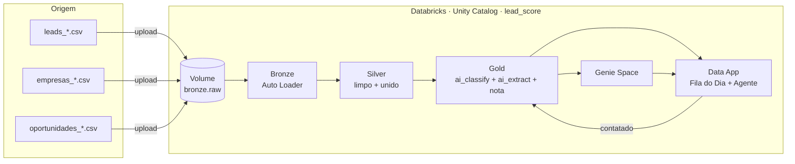

# PRD · Lead Score

> **300 leads por dia, capacidade para 20. Quais 20?**
> Priorização de leads com engenharia de dados + IA no Databricks, entregue ao time comercial como um Data App com agente conversacional.

| Campo | Valor |
|---|---|
| Projeto | **Lead Score** |
| Versão | **1.0** |
| Status | Especificado, aguardando desenvolvimento |
| Responsável | Alerrandro |
| Data | 18/11/2026 |
| Cliente (cenário) | Atlas Software, empresa fictícia de software B2B |
| Uso | Workshop de ~50 min para engenheiros e analistas de dados |
| Ambiente | Databricks · perfil `pessoal` · catálogo `lead_score` · bundle `databricks.yml` |

---

# FASE 1 · O PROBLEMA DE NEGÓCIO

## 1.1 Contexto

A Atlas Software vende cinco produtos por assinatura (Atlas Gestão, Atlas BI, Atlas Fiscal, Atlas CRM e Atlas Estoque). O marketing funciona bem: chegam **cerca de 300 leads por dia** pelo site, LinkedIn, eventos, indicações e campanhas pagas.

O time comercial tem **4 vendedores**. Cada um consegue fazer cerca de **5 conversas de qualidade por dia** (ligação, diagnóstico, follow-up). Capacidade total: **20 leads por dia**.

## 1.2 A matemática que abre a apresentação

```
 300 leads chegam por dia
  20 leads são atendidos      →  6,7% da demanda
 280 leads ficam sem contato  →  93,3% da demanda
```

O time **nunca vai falar com todos**. Contratar 14× mais vendedores não é opção. A pergunta deixa de ser "como atender todo mundo?" e passa a ser:

> ### **Se só posso falar com 20, como garanto que são os 20 certos?**

## 1.3 Declaração do problema

> **O time comercial escolhe os 20 leads do dia por ordem de chegada ou por intuição, lendo mensagem por mensagem. Leads prontos para comprar se perdem no meio de curiosos, pedidos de suporte e spam, e esfriam antes de serem contatados. A conversão está em torno de 3%.**

## 1.4 Linha de base (hoje)

| Indicador | Hoje |
|---|---|
| Leads recebidos | ~300 por dia |
| Capacidade de contato | 20 por dia (4 vendedores × 5) |
| Critério de escolha | Ordem de chegada / intuição |
| Tempo gasto triando mensagens | ~1 h por vendedor por dia |
| Conversão dos leads contatados | ~3% |
| Vendas por dia (20 × 3%) | **~0,6** |

## 1.5 Causa-raiz (5 porquês)

1. **Por que vendemos pouco?** Porque os 20 contatos do dia são, em boa parte, leads que não iam comprar.
2. **Por que escolhemos os leads errados?** Porque a escolha é por ordem de chegada.
3. **Por que por ordem de chegada?** Porque não existe um critério de prioridade.
4. **Por que não existe critério?** Porque o sinal de intenção está **escondido em texto livre** ("preciso de 200 licenças até dezembro") e espalhado em arquivos diferentes (lead, empresa, histórico).
5. **Por que ninguém usa esse sinal?** Porque ler 300 mensagens por dia não escala para humanos.

**Causa-raiz:** o sinal de compra existe, mas está em texto não estruturado e em fontes separadas. Falta um pipeline que **una os dados e transforme texto em atributo**.

## 1.6 Hipótese de valor

> **Se** unirmos os dados do lead, da empresa e do histórico comercial, **e** usarmos IA para transformar a mensagem livre em intenção e dados estruturados, **então** os 20 contatos diários irão para os leads com maior chance de compra, **e** as vendas sobem **sem aumentar o time**.

## 1.7 O tamanho do prêmio (cenário ilustrativo para a apresentação)

| Cenário | Leads contatados/dia | Conversão | Vendas/dia | Vendas/mês (22 dias úteis) |
|---|---|---|---|---|
| Hoje (ordem de chegada) | 20 | 3% | 0,6 | ~13 |
| Com priorização (meta) | 20 | 12% | 2,4 | ~53 |

> Mesmo time, mesma verba de marketing, **4× mais vendas**. O ganho vem só de escolher melhor.
> *(Números do cenário fictício. A meta de 12% é validada no backtest da seção 3.2.)*

## 1.8 Stakeholders

| Persona | Necessidade | Decisão que o produto apoia |
|---|---|---|
| **Vendedor** | Saber para quem ligar e o que falar | Quais são os meus 5 leads de hoje |
| **Gestor comercial** | Distribuir a fila e acompanhar o resultado | Quem atende quem; o funil está saudável? |
| **Marketing** | Saber que canal traz comprador, não só volume | Onde investir a verba |
| **Engenharia/Analytics** | Pipeline simples, reprocessável e governado | Operação e evolução |

## 1.9 Métricas de sucesso

| Tipo | Métrica | Meta |
|---|---|---|
| ⭐ Negócio | Conversão dos 20 leads priorizados do dia | ≥ 4× a linha de base (≥ 12%) |
| Negócio | Leads "compra imediata" que ficaram **fora** da fila do dia | ≤ 5% |
| Operação | Tempo de triagem por vendedor | De ~1 h para ~0 |
| Operação | Fila do dia disponível no app | Até 8h da manhã |
| IA | Acurácia do `ai_classify` contra o gabarito | ≥ 85% |
| Dados | Leads duplicados na Silver | 0 |

### ✅ Portão 1
- [x] Problema declarado em uma frase
- [x] Restrição de capacidade quantificada (300 → 20)
- [x] Linha de base e causa-raiz
- [x] Métricas com meta numérica

---

# FASE 2 · A SOLUÇÃO

## 2.1 Visão geral

```
 CSVs do dia ──► Volume "raw" ──► Bronze ──► Silver ──► Gold ──► Data App
 (lead, empresa,   (Unity          (cru)     (limpo,    (IA +     (Fila do Dia
  histórico)        Catalog)                  unido)     nota)     + Agente)
                                                 │
                                    ai_classify + ai_extract
```

## 2.2 Escopo

**Dentro (MVP)**
- Ingestão incremental de CSVs a partir do Volume `raw`.
- Limpeza, deduplicação e junção das três fontes.
- `ai_classify` para intenção; `ai_extract` para dados escondidos na mensagem.
- Nota de prioridade (0–100), explicável, e a **Fila do Dia** com os 20 melhores.
- Data App com a fila por vendedor e um agente conversacional sobre os leads.

**Fora (próximas versões)**
- Integração direta com CRM, banco ou APIs.
- Texto gerado por LLM (`ai_query`) para resumo e abordagem.
- Escrita de volta no CRM e disparo automático de mensagens.
- Modelo de ML treinado com o histórico.

## 2.3 Histórias de usuário

| ID | Como... | Quero... | Para... |
|---|---|---|---|
| US-01 | vendedor | abrir o app e ver **meus 5 leads do dia** | não perder tempo triando |
| US-02 | vendedor | ver **por que** o lead está na fila e o que ele pediu | chegar na ligação preparado |
| US-03 | vendedor | marcar o lead como contatado | o gestor acompanhar sem planilha |
| US-04 | gestor | perguntar em português "quantos leads quentes ficaram fora da fila hoje?" | decidir sem depender de analista |
| US-05 | marketing | perguntar "qual canal trouxe mais compra imediata esta semana?" | investir no canal certo |
| US-06 | eng. de dados | reprocessar um dia sem duplicar | operar com segurança |

## 2.4 Fontes de dados (CSV → Volume `raw`)

O contexto: todo dia os sistemas de origem (formulário do site, CRM e base cadastral) **exportam CSVs**, que são enviados ao Volume do Unity Catalog. A partir daí, tudo acontece no Databricks.

**Local:** `/Volumes/lead_score/bronze/raw/`. As três fontes ficam na mesma pasta, e o Auto Loader separa cada uma pelo **padrão do nome do arquivo**.

| Padrão do arquivo | Tabela Bronze | Origem simulada | Conteúdo | Chave |
|---|---|---|---|---|
| `leads_*.csv` | `bronze.leads` | Formulário do site + LinkedIn + eventos | `lead_id`, nome, e-mail, telefone, cnpj, canal, campanha, **mensagem (texto livre)**, `recebido_em` | `lead_id`, e-mail |
| `empresas_*.csv` | `bronze.empresas` | Base cadastral | cnpj, razão social, porte, segmento, nº de funcionários, UF | cnpj |
| `oportunidades_*.csv` | `bronze.oportunidades` | Export do CRM | cnpj, produto, status (ganha/perdida/aberta), valor, data | cnpj + oportunidade |

**Arquivos do workshop**
- `leads_DEMO.csv` com 300 leads do "dia de hoje", subido **ao vivo**, contendo pegadinhas planejadas (seção 3.1).
- `gabarito/intencao.csv` e `gabarito/entidades.csv` em `/Volumes/lead_score/bronze/gabarito/`, fora do `raw`, com o rótulo correto de cada mensagem.
- ⏳ **Pendente:** 3 dias de histórico (~900 leads) com desfecho (vendeu ou não). Ainda não foram gerados e são pré-requisito do backtest (3.2).

## 2.5 As duas funções de IA

> **Ideia para o slide:** `ai_classify` responde **"em qual caixa esse texto cai?"**. `ai_extract` responde **"que dados estão escondidos nesse texto?"**. As duas são funções SQL: rodam onde o dado já está, governadas pelo Unity Catalog, sem endpoint ou infraestrutura extra.

### `ai_classify`: transforma texto em categoria

**O que faz:** recebe um texto e uma lista de rótulos definidos por nós e devolve o rótulo que melhor descreve o texto. Na versão atual (2.1, recomendada) os rótulos podem levar uma **descrição**, o que funciona como uma instrução de negócio para o modelo, e a função aceita opções como instruções extras.

**No Lead Score:** classifica a intenção da mensagem do lead.

| Rótulo | Descrição passada ao modelo |
|---|---|
| `compra_imediata` | Pede preço, proposta, quantidade de licenças, prazo ou reunião comercial |
| `avaliando` | Quer conhecer o produto, comparar opções ou ver uma demonstração, sem urgência |
| `suporte` | Já é cliente e relata problema, dúvida de uso ou pede ajuda técnica |
| `spam` | Sem relação com compra: propaganda, teste, texto sem sentido |

```sql
ai_classify(
  mensagem,
  '{
    "compra_imediata": "Pede preço, proposta, quantidade de licenças, prazo ou reunião comercial",
    "avaliando":       "Quer conhecer, comparar ou ver demo, sem urgência",
    "suporte":         "Já é cliente e relata problema ou dúvida de uso",
    "spam":            "Sem relação com compra"
  }',
  map('version', '2.1')
) AS intencao_raw
-- retorna VARIANT: intencao_raw:response[0].value::string
```

### `ai_extract`: transforma texto em colunas

**O que faz:** recebe um texto e um **schema** (os campos que queremos, com tipo e descrição) e devolve esses campos preenchidos com o que encontrou no texto. Quando o dado não está no texto, o campo volta nulo. É o que transforma "preciso de 200 licenças do ERP até dezembro, orçamento aprovado" em colunas consultáveis.

**No Lead Score:**

| Campo | Exemplo extraído |
|---|---|
| `produto` | Atlas Gestão |
| `qtd_licencas` | 200 |
| `prazo` | dezembro |
| `orcamento_aprovado` | sim |
| `cargo` | Diretor Financeiro |
| `concorrente_citado` | (nome do concorrente, se houver) |

```sql
ai_extract(
  mensagem,
  '{
    "produto":            {"type": "string",  "description": "Produto Atlas citado"},
    "qtd_licencas":       {"type": "integer", "description": "Quantidade de licenças ou usuários"},
    "prazo":              {"type": "string",  "description": "Prazo ou data desejada"},
    "orcamento_aprovado": {"type": "boolean", "description": "Mencionou orçamento aprovado"},
    "cargo":              {"type": "string",  "description": "Cargo de quem escreveu"},
    "concorrente_citado": {"type": "string",  "description": "Concorrente mencionado"}
  }',
  map('version', '2.1')
) AS entidades_raw
-- retorna VARIANT; cada campo vem em {"value": ...}:
-- entidades_raw:response.qtd_licencas.value::int
```

**Salvaguardas**
- A IA **sugere**; o vendedor decide.
- Mensagem vazia ou com menos de 5 caracteres vira `spam` sem chamar a IA (custo zero).
- A IA roda **apenas em leads novos** (incremental), nunca na base inteira.
- A versão da função fica registrada junto do resultado, para auditoria.

## 2.6 Requisitos funcionais

### Bronze: ingestão
| ID | Requisito |
|---|---|
| RF-01 | Ler os CSVs `leads_*`, `empresas_*` e `oportunidades_*` com **Auto Loader**, processando cada arquivo uma única vez. |
| RF-02 | Guardar o dado como veio, com `_arquivo` e `_ingerido_em`. Linhas malformadas vão para `_rescued_data`, sem parar o pipeline. |

### Silver: tratamento
| ID | Requisito |
|---|---|
| RF-03 | Normalizar e-mail e CNPJ (14 dígitos, dígito verificador validado). |
| RF-04 | Deduplicar leads pelo e-mail normalizado, mantendo a mensagem mais recente. |
| RF-05 | Juntar lead + empresa (por CNPJ) + histórico agregado da empresa (oportunidades ganhas, cliente ativo). |
| RF-06 | Aplicar regras de qualidade (expectations) e registrar violações. |

### Gold: inteligência
| ID | Requisito |
|---|---|
| RF-07 | Classificar a intenção com `ai_classify` (seção 2.5). |
| RF-08 | Extrair entidades com `ai_extract` (seção 2.5). |
| RF-09 | Calcular a nota de prioridade de 0 a 100 (seção 2.7), com os componentes visíveis. |
| RF-10 | Montar o **motivo** ("Pediu 200 licenças do Atlas Gestão até dezembro · empresa grande") e o **próximo passo** por regra, a partir da intenção e das entidades. |
| RF-11 | Publicar `gold.fila_do_dia`: os **20 leads** de maior nota, distribuídos entre os 4 vendedores (5 cada). |
| RF-12 | Publicar `gold.leads_classificados` com **todos** os leads (para análise e para o agente). |

### Consumo: Data App
| ID | Requisito |
|---|---|
| RF-13 | Tela **Fila do Dia**: o vendedor vê seus 5 leads em cards com nota, intenção, motivo, entidades extraídas e próximo passo. |
| RF-14 | Botão **Marcar como contatado**, registrado em tabela de feedback. |
| RF-15 | Tela **Visão do Gestor**: funil do dia (recebidos → classificados → na fila → contatados) e distribuição por intenção e canal. |
| RF-16 | **Agente conversacional** integrado ao app (Genie Space sobre as tabelas Gold, via Genie Conversation API) respondendo perguntas sobre leads em português. |

> Layout e navegação das telas RF-13 a RF-16 seguem a seção **2.8 · Referência visual**.

## 2.7 Regra de negócio: nota de prioridade

```
nota = 0,50 × intenção + 0,25 × perfil + 0,15 × sinais + 0,10 × recência
```

| Componente | Fonte | Cálculo |
|---|---|---|
| **Intenção** | `ai_classify` | compra_imediata = 100 · avaliando = 40 · suporte = 0 · spam = 0 |
| **Perfil** | CSV empresas + histórico | Porte (grande 100 · médio 60 · pequeno 30 · desconhecido 20), +bônus se já é cliente de outro produto (cross-sell) |
| **Sinais** | `ai_extract` | +40 orçamento aprovado · +30 prazo informado · +30 quantidade informada (máx. 100) |
| **Recência** | `recebido_em` | 100 no dia, 50 no dia seguinte, 0 após 3 dias |

**Travas:** `spam` → nota 0, próximo passo "Descartar". `suporte` → fora da fila comercial, próximo passo "Encaminhar ao suporte".

**Explicabilidade:** todo lead mostra os 4 componentes. O vendedor sempre sabe **por que** o lead está na fila.

## 2.8 O Data App como produto de dados

Um produto de dados não é uma tabela: é algo com **dono, usuário, contrato e qualidade**.

| Atributo | Lead Score |
|---|---|
| Dono | Engenharia de dados (pipeline) + Gestor comercial (regra da nota) |
| Usuários | Vendedores, gestor comercial, marketing |
| Contrato (SLA) | Fila do dia pronta até 8h; leads novos ao longo do dia em até 15 min |
| Interface | Databricks App (web), com login do workspace |
| Qualidade | Expectations no pipeline + acurácia da IA monitorada |
| Feedback | Botão "contatado" e resultado da oportunidade alimentam a recalibração da nota |

### O agente conversacional

Integrado ao app como um painel de chat, conectado a um **Genie Space** configurado sobre `gold.leads_classificados`, `gold.fila_do_dia` e `gold.feedback_contatos`, com instruções e exemplos de perguntas do negócio.

**Perguntas que ele deve responder (roteiro da demo):**
1. "Quantos leads de compra imediata chegaram hoje?"
2. "Quais leads de compra imediata ficaram **fora** da fila de hoje?"
3. "Qual canal trouxe mais leads de compra imediata nesta semana?"
4. "Quais leads citaram concorrente?"
5. "Quantos leads da minha fila eu já contatei?"

### Referência visual

O Data App segue o **padrão visual e de navegação** de um Data App de referência feito em Databricks Apps. A referência vale para layout e componentes. O conteúdo é o do Lead Score.

**O que reaproveitar:**

| Padrão da referência | No Lead Score |
|---|---|
| Sidebar escura com a marca, menu em grupos (título + subtítulo técnico) e status dos serviços no rodapé | Menu: **Fila do Dia** · **Visão do Gestor** · **Agente** · **Plataforma**. Status no rodapé: SQL Warehouse · Genie |
| Banner (hero) com a frase do dia em números + 2 botões de ação | "20 leads na fila hoje · 33 de compra imediata · 13 ficaram de fora", com os botões **Ver minha fila** e **Perguntar ao agente** |
| Linha de KPI cards com borda de cor semântica e a tabela de origem no rodapé do card | Recebidos · Classificados · Na fila · Contatados · % compra imediata · Acurácia da IA (origem: `GOLD.FILA_DO_DIA`, `GOLD.LEADS_CLASSIFICADOS`) |
| Faixa "Da fonte à decisão" com etapas numeradas | CSV → Volume → Bronze → Silver → Gold (`ai_classify` / `ai_extract`) → Genie → App |
| Filtros globais no topo + selo "Demo · dados 100% sintéticos" | Filtros de **Vendedor** e **Canal**; mesmo selo de dados sintéticos |
| Tela do agente com cards de perguntas sugeridas e chips das ferramentas usadas | Cards com as perguntas do roteiro acima; chips **Genie** · **SQL Warehouse** |
| Alternância de tema claro/escuro | Mantém |

**O que não entra:**
- A marca, os nomes e os dados da referência.
- Lakebase, Vector Search, Model Serving e LLM externo: estão fora do escopo (D-04, D-05). O agente é o Genie Space.
- Simulador e ações gravadas em OLTP. O "contatado" continua numa tabela Delta de feedback (RF-14).

## 2.9 Arquitetura



### Decisões de arquitetura

| # | Decisão | Motivo | Alternativa descartada |
|---|---|---|---|
| D-01 | **CSV no Volume `raw`** como porta de entrada | Simples, reproduzível e sem dependência de rede | Conectores para banco/API (fica como evolução) |
| D-02 | **Auto Loader** em pipeline declarativo (Lakeflow) | Incremental e idempotente por padrão | Ler a pasta inteira a cada execução |
| D-03 | **AI Functions no SQL** (`ai_classify`, `ai_extract`) | Governado, sem endpoint, fácil de explicar | Endpoint de modelo próprio |
| D-04 | Motivo e próximo passo **por regra** | Determinístico, auditável e sem custo de LLM | `ai_query` (fica para evolução) |
| D-05 | **Databricks Apps** + Genie Conversation API | App e agente dentro do workspace, com a mesma governança | Power BI + chat externo |
| D-06 | Nota por **regra explícita** | Explicável e validável com o negócio | Modelo de ML (evolução) |

## 2.10 Modelo de dados (Gold)

**`gold.leads_classificados`** (todos os leads)

| Coluna | Tipo | Descrição |
|---|---|---|
| `lead_id` | string | Identificador do lead |
| `nome`, `email`, `empresa`, `canal`, `campanha` | string | Identificação e origem |
| `porte`, `segmento`, `uf`, `ja_cliente` | string/bool | Perfil da empresa |
| `mensagem` | string | Texto original |
| `intencao` | string | Saída do `ai_classify` |
| `produto`, `qtd_licencas`, `prazo`, `orcamento_aprovado`, `cargo`, `concorrente_citado` | vários | Saída do `ai_extract` |
| `nota` | int | 0 a 100 |
| `nota_componentes` | struct | intenção, perfil, sinais, recência |
| `motivo`, `proximo_passo` | string | Gerados por regra |
| `recebido_em`, `processado_em` | timestamp | Datas |

**`gold.fila_do_dia`**: `data`, `posicao` (1–20), `vendedor`, `lead_id` + colunas acima.
**`gold.feedback_contatos`**: `lead_id`, `vendedor`, `contatado_em`, `resultado`.

### ✅ Portão 2
- [x] Escopo e fora de escopo definidos
- [x] Fontes CSV e Volume definidos
- [x] Funções de IA especificadas com rótulos e schema
- [x] Regra da nota explícita
- [x] Produto de dados e agente especificados

---

# FASE 3 · VALIDAÇÃO

## 3.1 Critérios de aceite

| ID | Valida | Critério |
|---|---|---|
| CA-01 | RF-01, RF-02 | Subir `leads_DEMO.csv` gera **exatamente 300** registros na Bronze. Rodar de novo gera 0. |
| CA-02 | RF-02 | O arquivo com 3 linhas malformadas é ingerido; as 3 linhas aparecem em `_rescued_data`. |
| CA-03 | RF-03, RF-04 | A Silver tem **0 e-mails duplicados**; CNPJs com e sem máscara convergem. |
| CA-04 | RF-07 | Acurácia do `ai_classify` contra o gabarito **≥ 85%**. |
| CA-05 | RF-07 | Pelo menos **4 de 5 pegadinhas** classificadas corretamente (ex.: cliente reclamando que "quer comprar mais licenças, mas o sistema está fora do ar"). |
| CA-06 | RF-08 | Na mensagem das "200 licenças", `ai_extract` traz produto = Atlas Gestão, qtd = 200, prazo = dezembro, orçamento = true. |
| CA-07 | RF-09 | Nenhum `spam` ou `suporte` aparece na fila do dia. |
| CA-08 | RF-11 | A fila tem 20 leads, 5 por vendedor, ordenados por nota, todos com os 4 componentes. |
| CA-09 | RF-13, RF-14 | O vendedor vê seus 5 leads e marca um como contatado; o registro aparece em `feedback_contatos`. |
| CA-10 | RF-16 | O agente responde corretamente as 5 perguntas do roteiro (2.8). |
| CA-11 | Custo | Segunda execução sem arquivos novos faz **0 chamadas** de IA. |
| CA-12 | SLA | Do upload do CSV até o lead aparecer no app: ≤ 15 min. |

## 3.2 Backtest: a prova de valor

> ⏳ **Pendente:** os dados atuais não têm histórico de leads com desfecho. O backtest depende de gerar esses dias em `gerar_csvs.py`.

Aplicar a nota aos 3 dias de histórico, cujo desfecho é conhecido, e responder:

> **Se tivéssemos contatado os 20 leads de maior nota em cada dia, quantas vendas teríamos feito, comparado aos 20 primeiros por ordem de chegada?**

Se o top 20 converte **≥ 4×** a ordem de chegada, a hipótese (1.6) está sustentada. Se não, os pesos (2.7) são recalibrados com o gestor comercial.

## 3.3 Riscos

| Risco | Prob. | Impacto | Mitigação |
|---|---|---|---|
| IA classifica errado | Média | Médio | Gabarito, travas da nota e decisão humana |
| AI Functions indisponíveis na região/edição | Baixa | Alto | Validar no notebook 00; resultado pré-processado como plano B |
| Genie responde errado | Média | Médio | Instruções e exemplos de SQL no Genie Space; perguntas testadas |
| Falha ao vivo na demo | Média | Alto | Pipeline pré-executado, app já publicado e vídeo de backup |

### ✅ Portão 3 (entrega)
- [ ] CA-01 a CA-12 aprovados
- [ ] Backtest com top 20 ≥ 4× a ordem de chegada (⏳ depende do histórico com desfecho)
- [ ] Ensaio completo da demo dentro de 50 min

---

# 4 · Desenvolvimento

| Marco | Entrega | Requisitos | Pronto quando |
|---|---|---|---|
| **M0** · Dados e ambiente | CSVs sintéticos, bundle `databricks.yml` (perfil `pessoal`, catálogo `lead_score`), Volumes `raw` e `gabarito`, teste das AI Functions | — | Notebook 00 OK |
| **M1** · Bronze | Auto Loader das 3 pastas | RF-01, RF-02 | CA-01, CA-02 |
| **M2** · Silver | Limpeza, deduplicação e junção | RF-03 a RF-06 | CA-03 |
| **M3** · Gold | IA, nota, fila | RF-07 a RF-12 | CA-04 a CA-08, CA-11 |
| **M4** · Data App | Fila, visão do gestor, agente | RF-13 a RF-16 | CA-09, CA-10, CA-12 |
| **M5** · Validação | Backtest e ensaio | — | Portão 3 |

**Matriz de rastreabilidade**

| Problema | Requisitos | Aceite |
|---|---|---|
| Dados em arquivos separados | RF-01 a RF-05 | CA-01 a CA-03 |
| Intenção escondida no texto | RF-07, RF-08 | CA-04 a CA-06 |
| Sem critério para escolher os 20 | RF-09 a RF-11 | CA-07, CA-08 |
| Vendedor perde tempo triando | RF-13, RF-14 | CA-09 |
| Gestor e marketing dependem de analista | RF-15, RF-16 | CA-10 |
| Conversão de 3% | Todos | Backtest (3.2) |

---

# 5 · Roteiro da apresentação (50 min)

| Tempo | Bloco | Mensagem principal |
|---|---|---|
| 0–5 | **O problema** | "300 leads, 20 conversas. Quais 20?" A matemática do funil (1.2). |
| 5–10 | **Por que hoje dá errado** | Ordem de chegada; o sinal está no texto livre; 5 porquês (1.5). |
| 10–13 | **O tamanho do prêmio** | Mesmo time, 4× mais vendas (1.7). |
| 13–18 | **Arquitetura** | CSV → Volume → Medalhão → IA → App (2.9). |
| 18–30 | **Demo 1: pipeline + IA** | Subir `leads_DEMO.csv` ao vivo; mostrar `ai_classify` e `ai_extract` numa consulta; ver as pegadinhas. |
| 30–40 | **Demo 2: Data App** | Vendedor abre a fila; gestor pergunta ao agente "quais compra imediata ficaram fora da fila?". |
| 40–45 | **Prova de valor** | Backtest: top 20 vs ordem de chegada. |
| 45–50 | **Evolução + perguntas** | Conectar CRM/API, `ai_query`, ML, reverse ETL. |

---

# 6 · Glossário

| Termo | Significado |
|---|---|
| Lead | Contato com potencial de compra |
| Volume | Área de arquivos governada pelo Unity Catalog |
| Auto Loader | Ingestão incremental de arquivos: cada arquivo é lido uma vez |
| Medalhão | Camadas Bronze (cru), Silver (tratado) e Gold (pronto para o negócio) |
| `ai_classify` | Função SQL que coloca um texto em uma das categorias definidas |
| `ai_extract` | Função SQL que tira campos estruturados de um texto, segundo um schema |
| Genie | Interface de perguntas em linguagem natural sobre tabelas |
| Databricks Apps | Aplicações web hospedadas dentro do workspace Databricks |
| Produto de dados | Entrega de dados com dono, usuário, contrato e qualidade |
| Backtest | Aplicar a regra ao passado para medir se teria acertado |
