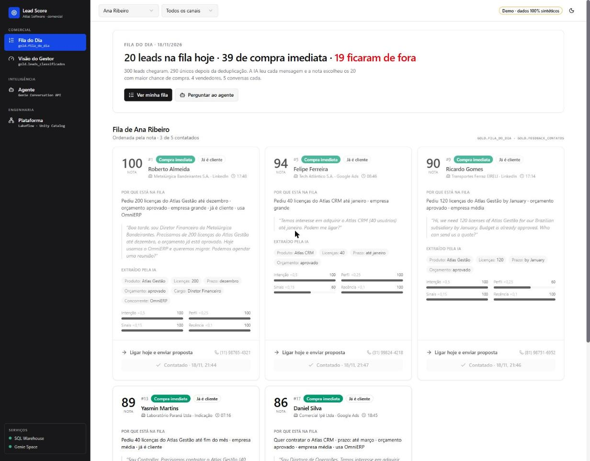
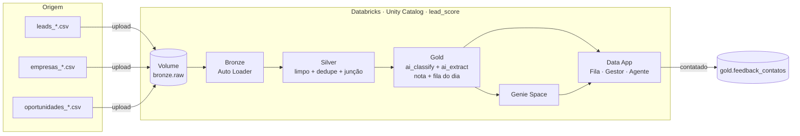
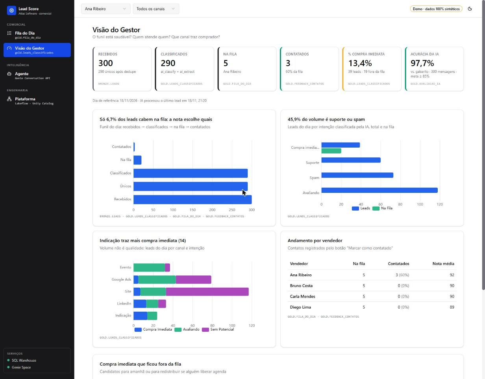
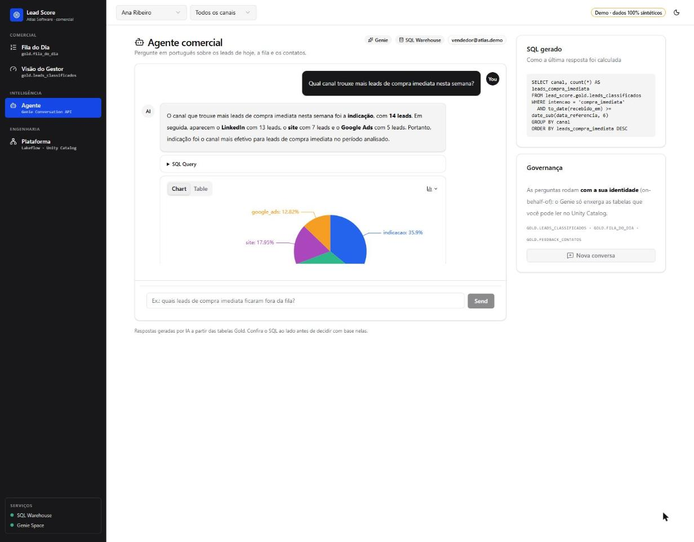
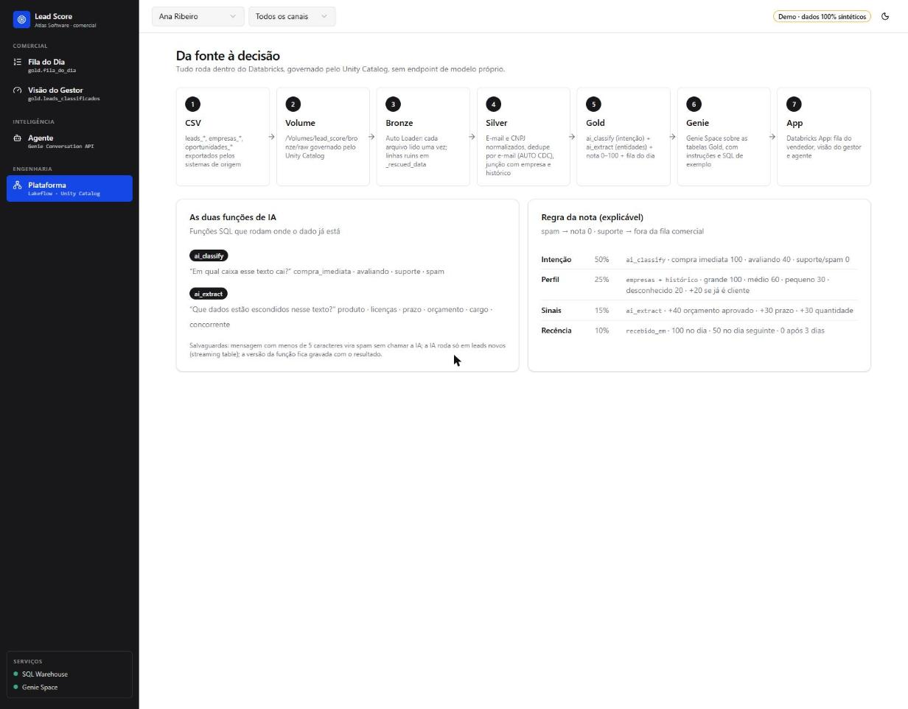

# Lead Score

> **300 leads por dia, capacidade para 20. Quais 20?**
> Priorização de leads com engenharia de dados + IA no Databricks, entregue ao time comercial como um Data App com agente conversacional.

`Databricks` · `Unity Catalog` · `Lakeflow Declarative Pipelines` · `AI Functions (ai_classify / ai_extract)` · `Genie` · `Databricks Apps (AppKit)` · `Declarative Automation Bundles`



---

## Sumário

1. [O problema de negócio](#1-o-problema-de-negócio)
2. [Como foi resolvido](#2-como-foi-resolvido)
3. [Resultados](#3-resultados)
4. [O Data App](#4-o-data-app)
5. [Estrutura do repositório](#5-estrutura-do-repositório)
6. [Passo a passo: do zero ao vivo](#6-passo-a-passo-do-zero-ao-vivo)
   - [0. Pré-requisitos e ferramentas](#0-pré-requisitos-e-ferramentas) (inclui o AI Dev Kit)
   - [1. Autenticar no workspace](#1-autenticar-no-workspace)
   - [2. Gerar os dados sintéticos](#2-gerar-os-dados-sintéticos)
   - [3. Bundle, catálogo, schemas e volumes](#3-bundle-catálogo-schemas-e-volumes)
   - [4. Subir os CSVs e testar a IA](#4-subir-os-csvs-e-testar-a-ia)
   - [5. Pipeline Bronze → Silver → Gold](#5-pipeline-bronze--silver--gold)
   - [6. Momento ao vivo: subir os leads do dia](#6-momento-ao-vivo-subir-os-leads-do-dia)
   - [7. Genie Space (o agente)](#7-genie-space-o-agente)
   - [8. Data App (AppKit)](#8-data-app-appkit)
   - [9. Checklist final](#9-checklist-final)
   - [Problemas comuns](#problemas-comuns)
7. [Resetar a demo](#7-resetar-a-demo)
8. [Próximos passos](#8-próximos-passos)

---

## 1. O problema de negócio

A **Atlas Software** (empresa fictícia de software B2B) vende cinco produtos por assinatura. O marketing funciona: chegam **cerca de 300 leads por dia** (site, LinkedIn, eventos, indicações, Google Ads). O time comercial tem **4 vendedores**, cada um com cerca de **5 conversas de qualidade por dia**.

```
 300 leads chegam por dia
  20 leads são atendidos      →  6,7% da demanda
 280 leads ficam sem contato  →  93,3% da demanda
```

Contratar 14× mais vendedores não é opção. A pergunta deixa de ser "como atender todo mundo?" e vira:

> **Se só posso falar com 20, como garanto que são os 20 certos?**

**Hoje:** os 20 do dia são escolhidos por ordem de chegada ou por intuição, lendo mensagem por mensagem (~1 h por vendedor). A conversão fica em torno de **3%**, ou seja, **~0,6 venda por dia**.

**Causa-raiz (5 porquês):** o sinal de compra existe ("preciso de 200 licenças até dezembro, orçamento aprovado"), mas está **escondido em texto livre** e espalhado em **arquivos separados** (lead, empresa, histórico comercial). Ler 300 mensagens por dia não escala para humanos.

**Hipótese de valor:** se unirmos lead + empresa + histórico **e** usarmos IA para transformar a mensagem em intenção e dados estruturados, os 20 contatos vão para os leads com maior chance de compra, e as vendas sobem **sem aumentar o time**.

| Cenário | Leads/dia | Conversão | Vendas/dia | Vendas/mês |
|---|---|---|---|---|
| Hoje (ordem de chegada) | 20 | 3% | 0,6 | ~13 |
| Com priorização (meta) | 20 | 12% | 2,4 | ~53 |

*Mesmo time, mesma verba: **4× mais vendas**. Números do cenário fictício; a especificação completa está no [PRD](PRD.md).*

---

## 2. Como foi resolvido



### As camadas

| Camada | Arquivo | O que faz |
|---|---|---|
| **Bronze** | [`src/pipeline/bronze.sql`](src/pipeline/bronze.sql) | 3 streaming tables com **Auto Loader** (`read_files`) lendo a mesma pasta e separando as fontes pelo nome do arquivo (`pathGlobFilter`). Schema explícito: linhas com data malformada vão para `_rescued_data` sem parar o pipeline. Cada arquivo é lido **uma única vez**. |
| **Silver** | [`src/pipeline/silver.sql`](src/pipeline/silver.sql) | Normaliza e-mail e CNPJ e **valida o dígito verificador** em SQL puro. Aplica expectations de qualidade. Deduplica por e-mail com **AUTO CDC (SCD 1)**, ficando a mensagem mais recente. Junta lead + empresa + histórico comercial. |
| **Gold** | [`src/pipeline/gold.sql`](src/pipeline/gold.sql) | `gold.leads_ia` (streaming: a IA roda **só nos leads novos**), `gold.leads_classificados` (nota explicável, motivo, próximo passo), `gold.fila_do_dia` (top 20, 5 por vendedor) e `gold.avaliacao_ia` (IA vs. gabarito). |

### As duas funções de IA

`ai_classify` responde **"em qual caixa esse texto cai?"**. `ai_extract` responde **"que dados estão escondidos nesse texto?"**. As duas são funções SQL: rodam onde o dado já está, governadas pelo Unity Catalog, sem endpoint próprio.

```sql
ai_classify(mensagem, '{
  "compra_imediata": "Pede preço, proposta, quantidade de licenças, prazo ou reunião comercial",
  "avaliando":       "Quer conhecer, comparar ou ver demo, sem urgência",
  "suporte":         "Já é cliente e relata problema ou dúvida de uso",
  "spam":            "Sem relação com compra"
}', map('version', '2.1'))                       -- :response[0].value

ai_extract(mensagem, '{
  "produto":            {"type": "string",  "description": "Produto Atlas citado"},
  "qtd_licencas":       {"type": "integer", "description": "Quantidade de licenças ou usuários"},
  "prazo":              {"type": "string",  "description": "Prazo ou data desejada"},
  "orcamento_aprovado": {"type": "boolean", "description": "Mencionou orçamento aprovado"},
  "cargo":              {"type": "string",  "description": "Cargo de quem escreveu"},
  "concorrente_citado": {"type": "string",  "description": "Concorrente mencionado"}
}', map('version', '2.1'))                       -- :response.<campo>.value
```

**Salvaguardas:** mensagem com menos de 5 caracteres vira `spam` sem chamar a IA. A IA roda só em leads novos (reexecutar = 0 chamadas). A versão da função fica gravada junto do resultado.

### A regra da nota (0 a 100, explicável)

```
nota = 0,50 × intenção + 0,25 × perfil + 0,15 × sinais + 0,10 × recência
```

| Componente | Fonte | Cálculo |
|---|---|---|
| Intenção | `ai_classify` | compra imediata 100 · avaliando 40 · suporte 0 · spam 0 |
| Perfil | empresas + histórico | grande 100 · médio 60 · pequeno 30 · desconhecido 20 · +20 se já é cliente (máx. 100) |
| Sinais | `ai_extract` | +40 orçamento aprovado · +30 prazo · +30 quantidade (máx. 100) |
| Recência | `recebido_em` | 100 no dia · 50 no dia seguinte · 25 em 2 dias · 0 depois |

**Travas:** `spam` → nota 0 e "Descartar". `suporte` → fora da fila e "Encaminhar ao suporte". **Desempate da fila:** maior quantidade de licenças, depois ordem de chegada.

### Decisões de implementação

| Decisão | Por quê |
|---|---|
| A IA roda **antes** da deduplicação (sobre `silver.leads_limpos`) | Assim ela é uma streaming table incremental: cada linha nova é classificada uma vez. Custa ~300 chamadas em vez de 290. |
| Data malformada usa a data embutida no `lead_id` | O lead não some da fila do dia; o valor original fica em `_rescued_data`. |
| "Hoje" = `data_referencia` (último dia com leads), não `current_date()` | Torna a demo determinística em qualquer data. |
| Motivo e próximo passo **por regra**, não por LLM | Determinístico, auditável e sem custo. |
| O app é um **bundle separado** em `app/` | O AppKit (`databricks apps init / validate`) espera um projeto próprio; o bundle raiz exclui `app/**`. |
| Consultas que leem `feedback_contatos` recebem um parâmetro `rev` | O analytics do AppKit faz cache no servidor; o `rev` muda a cada clique e a cada carga da página. |

---

## 3. Resultados

Medidos com [`src/validacao/aceite.sql`](src/validacao/aceite.sql) sobre o `leads_DEMO.csv` (300 leads com pegadinhas planejadas):

| CA | Critério | Resultado |
|---|---|---|
| CA-01 | Bronze com exatamente 300 linhas; reexecutar gera 0 | ✅ 300 → 300 |
| CA-02 | 3 linhas malformadas em `_rescued_data` | ✅ 3 |
| CA-03 | 0 e-mails duplicados na Silver; CNPJ com/sem máscara convergem | ✅ 290 únicos, 0 duplicados |
| CA-04 | Acurácia do `ai_classify` ≥ 85% | ✅ **97,7%** |
| CA-05 | ≥ 4 de 5 pegadinhas corretas | ✅ **5 de 5** |
| CA-06 | Mensagem "200 licenças" extraída certo | ✅ Atlas Gestão · 200 · dezembro · orçamento aprovado |
| CA-07 | Nenhum spam/suporte na fila | ✅ 0 |
| CA-08 | 20 leads, 5 por vendedor, 4 componentes visíveis | ✅ e a mensagem herói (chegou às 17h48) em **#1** |
| CA-09 | Marcar contatado grava em `feedback_contatos` | ✅ |
| CA-10 | Agente responde as 5 perguntas do roteiro | ✅ |
| CA-11 | 2ª execução sem arquivos novos = 0 chamadas de IA | ✅ |
| CA-12 | Upload → app em ≤ 15 min | ⏳ medir no ensaio |

**Ponto de atenção para a demo:** a mensagem de spam *"Gostaria de anunciar no blog de vocês, qual o valor do post patrocinado?"* é classificada como `compra_imediata`, porque o rótulo diz "pede preço". É quase todo o erro da IA (7 de 300). É um bom gancho: **a descrição do rótulo é regra de negócio**. Ajustá-la ("quer *comprar* um produto Atlas" × "quer *vender ou anunciar* para a Atlas") corrige o caso.

**Pendente:** o backtest (PRD 3.2) depende de gerar 3 dias de histórico com desfecho.

---

## 4. O Data App

Databricks App em **AppKit** (React + TypeScript), lendo as tabelas Gold pelo SQL Warehouse e conversando com o Genie Space pela Conversation API.

### Fila do Dia
O vendedor vê seus 5 leads com nota, intenção, **por que está na fila**, a mensagem original, os dados extraídos pela IA, os 4 componentes da nota, o próximo passo e o botão **Marcar como contatado**.


### Visão do Gestor
KPIs com a tabela de origem no rodapé, funil do dia, intenção por canal (volume não é qualidade), andamento por vendedor e os leads de compra imediata que ficaram fora.



### Agente
Perguntas em português sobre os leads, com cards das perguntas do roteiro, o **SQL gerado** visível e a nota de governança (as consultas rodam com a identidade do usuário).



### Plataforma
"Da fonte à decisão": o caminho do CSV até o app, as duas funções de IA e a regra da nota.



---

## 5. Estrutura do repositório

```
lead_score/
├── .claude/skills/                 # AI Dev Kit: skills do Databricks para o Claude Code
├── PRD.md                          # especificação do produto (problema, solução, critérios de aceite)
├── databricks.yml                  # bundle raiz: variáveis, targets (perfil pessoal), sync.exclude
├── resources/
│   ├── lead_score.pipeline.yml     # pipeline SDP serverless
│   └── setup.job.yml               # job: schemas/volumes/feedback + smoke test da IA
├── src/
│   ├── setup/00_ambiente.sql       # schemas, volumes, gold.feedback_contatos
│   ├── setup/00_teste_ai.sql       # ai_classify + ai_extract na mensagem herói
│   ├── setup/01_permissoes_app.sql # GRANTs do service principal do app
│   ├── pipeline/bronze.sql         # Auto Loader ×3
│   ├── pipeline/silver.sql         # normalização, CNPJ, AUTO CDC, junção
│   ├── pipeline/gold.sql           # IA, nota, fila, avaliação
│   ├── validacao/aceite.sql        # CA-01..CA-11 numa consulta
│   └── genie/space.json            # Genie Space: tabelas, instruções, SQL de exemplo
├── data/
│   ├── gerar_csvs.py               # gerador determinístico (seed 42)
│   └── lead_score_dados/{raw,gabarito}/
├── app/                            # Data App (bundle próprio)
│   ├── databricks.yml / app.yaml   # recursos: SQL Warehouse + Genie Space
│   ├── config/queries/*.sql        # consultas tipadas (resumo_dia, fila_vendedor, ...)
│   ├── server/server.ts            # /api/contatos (INSERT) e /api/whoami
│   └── client/src/pages/           # FilaPage, GestorPage, AgentePage, PlataformaPage
└── docs/img/                       # capturas das telas
```

---

## 6. Passo a passo: do zero ao vivo

> Comandos escritos para **Git Bash** (Windows), Linux ou macOS. O perfil da CLI usado em todo o projeto é `pessoal` e o catálogo é `lead_score`. Troque `<WAREHOUSE_ID>`, `<SPACE_ID>` e `<SP_APPLICATION_ID>` pelos valores do seu workspace.

### 0. Pré-requisitos e ferramentas

**Na máquina**

| Ferramenta | Versão | Para quê | Como conferir |
|---|---|---|---|
| Databricks CLI | **≥ 1.20** (usado 1.22) | bundles, volumes, pipelines, Genie, Apps | `databricks --version` |
| Node.js | **22.x** | build e dev do Data App (AppKit) | `node -v` |
| npm | 10.x | gerenciador de pacotes do app | `npm -v` |
| Python | 3.12 | gerar os CSVs sintéticos | `python --version` |
| uv *(opcional)* | 0.6+ | rodar o Python do projeto | `uv --version` |
| Git | qualquer | versionar | `git --version` |
| Claude Code | — | agente de código que constrói o projeto ao vivo | `claude --version` |
| AI Dev Kit (Databricks skills) | **v0.2.32** (35 skills) | ensina o agente a usar bundles, pipelines, AI Functions, Genie e Apps | `databricks aitools version` |
| VS Code *(opcional)* | — | editar | — |

Instalação rápida:

```bash
# Databricks CLI
winget install Databricks.DatabricksCLI          # Windows
brew tap databricks/tap && brew install databricks   # macOS
curl -fsSL https://raw.githubusercontent.com/databricks/setup-cli/main/install.sh | sh   # Linux

# Node.js 22 LTS: https://nodejs.org  (ou: winget install OpenJS.NodeJS.LTS)
# uv: https://docs.astral.sh/uv/  (ou: pip install uv)
```

Conferir tudo de uma vez:

```bash
databricks --version && node -v && npm -v && python --version && git --version
```

**AI Dev Kit: skills do Databricks para o Claude Code**

É o que faz o agente "saber Databricks": cada skill (`databricks-pipelines`, `databricks-ai-functions`, `databricks-genie-agents`, `databricks-apps`, `databricks-dabs`...) traz as convenções e os comandos atuais da plataforma. Instale **no escopo do projeto**, a partir da raiz do repositório:

```bash
# Claude Code
npm install -g @anthropic-ai/claude-code      # ou: https://claude.com/claude-code

# AI Dev Kit (skills de https://github.com/databricks/databricks-agent-skills)
databricks aitools install --scope project --agents claude-code --skills-only
```

Isso grava as skills em `.claude/skills/` (lidas pelo Claude Code) e o estado em `.databricks/aitools/`. Conferir:

```bash
databricks aitools version     # Skills (project): v0.2.32 (35 skills, up to date)
databricks aitools list        # nome, versão e status de cada skill
ls .claude/skills              # databricks-core, databricks-pipelines, databricks-apps, ...
```

Para atualizar depois: `databricks aitools update`. Abra o `claude` na raiz do projeto: as skills aparecem sozinhas quando o pedido combina com elas (ex.: "crie o pipeline bronze/silver/gold" carrega `databricks-pipelines`).

> O `.claude/**` já está no `sync.exclude` do `databricks.yml` (passo 3), para as skills não subirem junto com o bundle.

**No workspace Databricks**

| Requisito | Como conferir |
|---|---|
| Unity Catalog habilitado e permissão para criar catálogo | `databricks catalogs list -p pessoal` |
| SQL Warehouse **serverless** (aqui: *Serverless Starter Warehouse*) | `databricks warehouses list -p pessoal` |
| **AI Functions** disponíveis na região | passo 4 (`00_teste_ai.sql`) |
| **Genie** e **Databricks Apps** habilitados | `databricks genie list-spaces -p pessoal` · `databricks apps list -p pessoal` |
| Pipelines serverless (Lakeflow) | passo 5 |

### 1. Autenticar no workspace

```bash
databricks auth login --host https://<seu-workspace>.cloud.databricks.com --profile pessoal
```

Conferir:

```bash
databricks auth profiles                 # o perfil "pessoal" deve aparecer como Valid
databricks current-user me -p pessoal    # mostra o seu usuário
databricks warehouses list -p pessoal    # anote o ID do warehouse → <WAREHOUSE_ID>
```

### 2. Gerar os dados sintéticos

O gerador é determinístico (seed 42): a mesma data gera sempre os mesmos arquivos, com a mensagem herói, 5 pegadinhas, 10 duplicados, 3 datas malformadas e 3 CNPJs inválidos.

```bash
cd data
python gerar_csvs.py --data 2026-11-18 --saida lead_score_dados     # ou: uv run python gerar_csvs.py ...
cd ..
```

Conferir:

```bash
ls data/lead_score_dados/raw data/lead_score_dados/gabarito
# raw: empresas_2026-11-18.csv  leads_DEMO.csv  oportunidades_2026-11-18.csv
# gabarito: entidades.csv  intencao.csv
wc -l data/lead_score_dados/raw/leads_DEMO.csv     # 301 (300 leads + cabeçalho)
```

### 3. Bundle, catálogo, schemas e volumes

**3.1 Criar o catálogo** (uma vez):

```bash
databricks catalogs create lead_score -p pessoal
```

**3.2 Criar o bundle.** Na raiz, crie o [`databricks.yml`](databricks.yml) (variáveis `catalog`, `schema_*`, `raw_volume_path`, `warehouse_id` com `lookup` pelo nome do warehouse, target `dev` com `profile: pessoal` e o `sync.exclude` de `.claude/**`, `.venv/**`, `data/**` e `app/**`). Depois crie:

- [`resources/setup.job.yml`](resources/setup.job.yml): job com duas `sql_task` (`00_ambiente.sql` e `00_teste_ai.sql`).
- [`resources/lead_score.pipeline.yml`](resources/lead_score.pipeline.yml): pipeline `serverless: true`, `catalog: lead_score`, `schema: gold`, `libraries.glob: ../src/pipeline/**`.
- [`src/setup/00_ambiente.sql`](src/setup/00_ambiente.sql): schemas `bronze/silver/gold`, volumes `bronze.raw` e `bronze.gabarito` e a tabela `gold.feedback_contatos`.

```bash
databricks bundle validate -p pessoal       # → Validation OK!
databricks bundle deploy   -p pessoal       # cria o job e o pipeline (ainda sem rodar)
databricks bundle run lead_score_setup -p pessoal
```

Conferir:

```bash
databricks schemas list lead_score -p pessoal           # bronze, silver, gold
databricks volumes list lead_score bronze -p pessoal    # raw, gabarito
```

### 4. Subir os CSVs e testar a IA

Suba **empresas, oportunidades e o gabarito**. O `leads_DEMO.csv` fica para o momento ao vivo (passo 6).

```bash
R=dbfs:/Volumes/lead_score/bronze
databricks fs cp data/lead_score_dados/raw/empresas_2026-11-18.csv      $R/raw/ -p pessoal
databricks fs cp data/lead_score_dados/raw/oportunidades_2026-11-18.csv $R/raw/ -p pessoal
databricks fs cp data/lead_score_dados/gabarito/intencao.csv  $R/gabarito/ -p pessoal
databricks fs cp data/lead_score_dados/gabarito/entidades.csv $R/gabarito/ -p pessoal
```

Conferir:

```bash
databricks fs ls $R/raw -p pessoal
databricks fs ls $R/gabarito -p pessoal
```

Testar as AI Functions na mensagem herói (plano B do risco 3.3 do PRD):

```bash
databricks experimental aitools tools query --file src/setup/00_teste_ai.sql -p pessoal --warehouse <WAREHOUSE_ID>
# intencao_raw  → {"response":[{"value":"compra_imediata"}], ...}
# entidades_raw → {"response":{"produto":{"value":"Atlas Gestão"},"qtd_licencas":{"value":200}, ...}}
```

### 5. Pipeline Bronze → Silver → Gold

Escreva os três arquivos em `src/pipeline/` ([bronze](src/pipeline/bronze.sql), [silver](src/pipeline/silver.sql), [gold](src/pipeline/gold.sql)) e rode:

```bash
databricks bundle deploy -p pessoal
databricks bundle run lead_score_pipeline -p pessoal
```

Sem o `leads_DEMO.csv`, o pipeline processa só empresas e oportunidades. É uma boa forma de "aquecer" o serverless antes da demo: a primeira execução leva alguns minutos.

Conferir:

```bash
databricks pipelines list-pipelines -p pessoal | grep lead_score
databricks experimental aitools tools query -p pessoal --warehouse <WAREHOUSE_ID> \
  "SELECT count(*) FROM lead_score.silver.empresas"          # 181
```

### 6. Momento ao vivo: subir os leads do dia

```bash
databricks fs cp data/lead_score_dados/raw/leads_DEMO.csv dbfs:/Volumes/lead_score/bronze/raw/ -p pessoal
databricks bundle run lead_score_pipeline -p pessoal
```

Validar todos os critérios de aceite numa consulta:

```bash
databricks experimental aitools tools query --file src/validacao/aceite.sql \
  -p pessoal --warehouse <WAREHOUSE_ID> --output csv
```

Consultas boas para mostrar no palco:

```sql
-- as 5 pegadinhas: o que a IA respondeu x o esperado
SELECT a.pegadinha, a.intencao_esperada, a.intencao_prevista, a.acertou, l.mensagem
FROM lead_score.gold.avaliacao_ia a JOIN lead_score.silver.leads_limpos l USING (lead_id)
WHERE a.pegadinha IS NOT NULL ORDER BY a.pegadinha;

-- a mensagem herói: chegou às 17h48 e foi para o topo
SELECT posicao, vendedor, nota, nota_componentes, motivo
FROM lead_score.gold.fila_do_dia ORDER BY posicao LIMIT 5;
```

Rodar o pipeline de novo prova a idempotência: a Bronze continua com 300 linhas e `gold.leads_ia` não cresce (0 chamadas de IA).

### 7. Genie Space (o agente)

A configuração do agente está em [`src/genie/space.json`](src/genie/space.json): as 3 tabelas Gold, column configs, instruções em português (o que é "hoje", "fora da fila", "minha fila"), joins e o SQL de exemplo das 5 perguntas do roteiro.

```bash
databricks genie create-space <WAREHOUSE_ID> \
  "$(node -e "process.stdout.write(JSON.stringify(require('./src/genie/space.json')))")" \
  --title "Lead Score · Agente comercial" \
  --description "Perguntas em português sobre os leads do dia, a fila e os contatos." \
  -p pessoal -o json
# anote o "space_id" → <SPACE_ID>
```

Conferir (as 5 perguntas do roteiro, CA-10):

```bash
databricks genie start-conversation <SPACE_ID> "Quais leads de compra imediata ficaram fora da fila de hoje?" -p pessoal -o json
```

### 8. Data App (AppKit)

**8.1 Ver os plugins e recursos disponíveis**

```bash
databricks apps manifest -p pessoal
```

**8.2 Scaffold** (o warehouse precisa estar ligado):

```bash
databricks apps init --name lead-score --package-manager npm \
  --features analytics,genie \
  --set analytics.sql-warehouse.id=<WAREHOUSE_ID> \
  --set genie.genie-space.id=<SPACE_ID> \
  --set "genie.genie-space.name=Lead Score · Agente comercial" \
  --description "Lead Score: fila do dia priorizada por IA + agente Genie" \
  --run none -p pessoal
mv lead-score app
```

No `app/databricks.yml`, troque `workspace.host` por `profile: pessoal`.

**8.3 Consultas tipadas.** Apague os exemplos e crie as consultas em `app/config/queries/` (`resumo_dia`, `fila_vendedor`, `por_intencao`, `por_canal`, `vendedores`, `canais`, `compra_fora_da_fila`). Depois gere os tipos:

```bash
cd app
export DATABRICKS_CONFIG_PROFILE=pessoal DATABRICKS_WAREHOUSE_ID=<WAREHOUSE_ID>
npx appkit generate-types --wait --no-cache       # todas as consultas com ✓ / cache HIT
```

**8.4 Código.**

- `server/server.ts`: plugins `analytics()`, `genie()`, `server()` + rotas `POST /api/contatos` (INSERT parametrizado em `gold.feedback_contatos`, validado com zod) e `GET /api/whoami`.
- `client/src/App.tsx`: sidebar escura, filtros globais (Vendedor, Canal), selo "dados sintéticos", tema claro/escuro.
- `client/src/pages/`: `FilaPage`, `GestorPage`, `AgentePage`, `PlataformaPage`.

Conferir localmente:

```bash
npm run typecheck && npm run lint:ast-grep
npm run dev            # http://localhost:8000 usando o seu perfil
databricks apps validate -p pessoal                # → All validation checks passed
```

**8.5 Deploy.** O primeiro deploy cria o app e o **service principal** dele, mas o build falha com `INSUFFICIENT_PERMISSIONS` porque o SP ainda não pode ler o catálogo. Isso é esperado:

```bash
databricks bundle deploy -p pessoal
databricks apps get lead-score -p pessoal -o json    # anote service_principal_client_id → <SP_APPLICATION_ID>
```

**8.6 Permissões mínimas do SP** ([`src/setup/01_permissoes_app.sql`](src/setup/01_permissoes_app.sql)). Rode **um GRANT por vez**:

```bash
SP=<SP_APPLICATION_ID>; WH=<WAREHOUSE_ID>
for g in \
  "GRANT USE CATALOG ON CATALOG lead_score TO \`$SP\`" \
  "GRANT USE SCHEMA ON SCHEMA lead_score.bronze TO \`$SP\`" \
  "GRANT USE SCHEMA ON SCHEMA lead_score.gold TO \`$SP\`" \
  "GRANT SELECT ON TABLE lead_score.bronze.leads TO \`$SP\`" \
  "GRANT SELECT ON SCHEMA lead_score.gold TO \`$SP\`" \
  "GRANT MODIFY ON TABLE lead_score.gold.feedback_contatos TO \`$SP\`"; do
  databricks experimental aitools tools query "$g" -p pessoal --warehouse $WH
done
databricks grants get-effective schema lead_score.gold --principal $SP -p pessoal   # SELECT, USE_SCHEMA
```

**8.7 Publicar e abrir**

```bash
databricks bundle deploy -p pessoal
databricks bundle run app -p pessoal                  # → App started successfully + URL
databricks apps get lead-score -p pessoal -o json     # app_status.state = RUNNING
```

### 9. Checklist final

- [ ] `aceite.sql` com todas as linhas `ok = true` (exceto o CA-12, que é manual)
- [ ] App abre na **Fila do Dia**: banner "20 leads na fila hoje · N de compra imediata · M ficaram de fora"
- [ ] Herói (Roberto Almeida, 200 licenças) em **#1**, com nota 100
- [ ] **Marcar como contatado** → a linha aparece em `gold.feedback_contatos` e o contador sobe
- [ ] **Visão do Gestor**: acurácia da IA ≥ 85% e funil "6,7% cabem na fila"
- [ ] **Agente**: as 5 perguntas do roteiro respondem, com o SQL visível
- [ ] Cronometrar do upload do CSV até o card no app (CA-12, ≤ 15 min)

### Problemas comuns

| Sintoma | Causa | Solução |
|---|---|---|
| `pnpm is unavailable` no `apps init` | pnpm não instalado | `--package-manager npm` |
| Typegen mostra `OFFLINE` | o `npm run typegen` não carrega o `.env` | `export DATABRICKS_CONFIG_PROFILE=... DATABRICKS_WAREHOUSE_ID=...` e `npx appkit generate-types --wait` |
| Build do app falha com `INSUFFICIENT_PERMISSIONS` | o SP do app ainda não tem GRANTs | passo 8.6 e depois redeploy |
| GRANTs "rodam" mas não aplicam | arquivo com várias instruções no `tools query` | um GRANT por chamada (loop do 8.6) |
| Contatado não aparece após recarregar | cache das consultas no servidor | parâmetro `rev` (já implementado em `lib/filtros.tsx`) |
| Pipeline fica em `INITIALIZING` | cold start do serverless | normal na 1ª execução; rode antes da demo para aquecer |
| `databricks fs ls /Volumes/...` falha | falta o prefixo | use `dbfs:/Volumes/...` |
| Upload enviou centenas de arquivos | `.claude`, `.venv`, `node_modules` no sync | `sync.exclude` no `databricks.yml` |

---

## 7. Resetar a demo

Limpar os contatos registrados durante o ensaio:

```sql
TRUNCATE TABLE lead_score.gold.feedback_contatos;
```

Para subir o `leads_DEMO.csv` de novo **ao vivo**, é preciso que o Auto Loader esqueça o arquivo:

```bash
databricks fs rm dbfs:/Volumes/lead_score/bronze/raw/leads_DEMO.csv -p pessoal
databricks bundle run lead_score_pipeline --full-refresh-all -p pessoal
```

> ⚠️ **Full refresh apaga e recria todas as tabelas do pipeline** (inclusive o checkpoint do Auto Loader e os resultados da IA). Use só para resetar o ambiente da demo; depois suba o CSV de novo (passo 6).

---

## 8. Próximos passos

- **Backtest** (PRD 3.2): gerar 3 dias de histórico com desfecho e comparar top 20 × ordem de chegada (meta ≥ 4×).
- **Integração com CRM / APIs** no lugar dos CSVs, e **reverse ETL** da fila para o CRM.
- **`ai_query`** para resumo do lead e sugestão de abordagem.
- **Modelo de ML** treinado com o histórico para recalibrar os pesos da nota.
- Ajustar as descrições dos rótulos do `ai_classify` (caso do spam "anunciar no blog").

---

*Dados 100% sintéticos. Atlas Software, seus produtos, pessoas e concorrentes são fictícios.*
